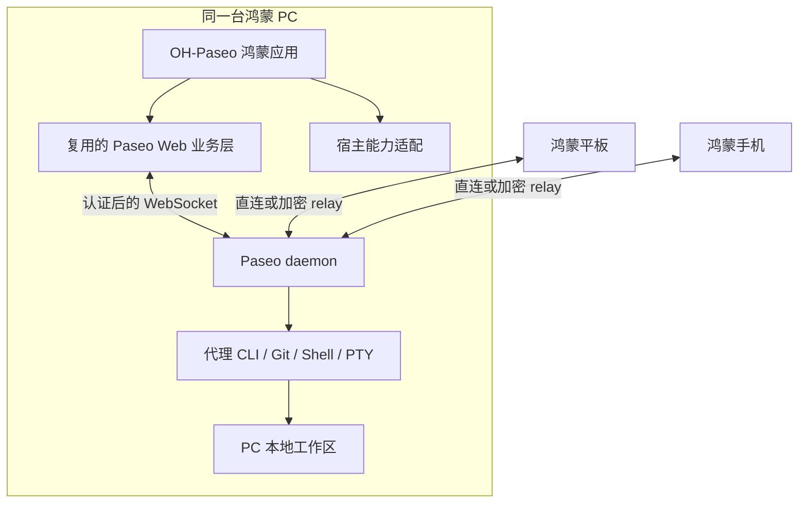

# OH-Paseo 开发计划


> 版本：供审阅 v0.2 · 2026-10-20
>
> 用户已明确：首版必须在鸿蒙 PC 本机完成开发工作，优先鸿蒙原生运行，暂不接受同机 Linux 融合开发引擎。测试机现已通过网络 hdc 连通；远程开发机不作为 PC 首版验收环境。

## 1. 目标与首版完成条件

项目交付三个设备形态的鸿蒙应用，顺序为 **PC → 平板 → 手机**。优先复用 Paseo 的业务界面、通信协议、状态同步和代理能力。

PC 首版的完整操作链：

1. 在鸿蒙 PC 上启动 OH-Paseo 和本机执行环境。
2. 在该 PC 的本地工作区创建代理任务。
3. 代理在该 PC 上运行，读取和修改该 PC 中的项目文件。
4. 界面实时显示输出、工具调用和权限请求。
5. 在集成终端运行 Git、Shell 和项目测试命令。
6. 查看改动和 diff，人工审阅，保留或撤销测试项目中的修改。
7. 前端断开、关闭后重新打开，能够找回工作区和任务状态。
8. 在同一 PC 上恢复工作，不依赖另一台 Mac、Windows 或 Linux 开发机提供 daemon。

“任务完成”需同时具备界面操作录像、daemon/代理实际进程信息、执行路径和 Git 改动证据。展示网页、运行 mock provider 或连接 Mac 上的 daemon，仅用于排查，不能通过此验收。

平板和手机首版连接上述鸿蒙 PC 的 daemon，完成任务下达、监看、权限响应和改动审阅；它们的本机 daemon 不列入首版范围。

## 2. 已确认的基础与待验证条件

| 项目 | 当前事实 | 对计划的影响 |
|---|---|---|
| OH-Paseo 代码 | 初始目录只有空 docs 和系统文件；本次新增规划文档 | 按新工程建立结构 |
| Paseo 上游 | 已阅读 main 固定提交 `3081b99b06aa29bf39b9a83aaed73cf854e4a89b` | 所有结论有可复查的源码基线 |
| 稳定版本 | 查询到最新 release `v0.12.0`，tag 对应提交 `cafe4b01c8522ff39560241c5deb01427dc8dc5b` | 建议开发从稳定版本开始，P0 核对与调研快照的差异 |
| 客户端架构 | Expo / React Native；Web 和 Electron 桌面版共享 app | 可复用 Web 业务层，无需先重写整个 UI |
| 当前依赖 | app：Expo 57、RN 0.86.3；desktop：Electron 44.2.0 | RNOH 和鸿蒙 Electron 需逐项核对，不能直接套用 |
| daemon 依赖 | Node.js、node-pty、进程创建、Git、外部代理；含 sherpa-onnx-node 语音依赖 | 本机移植是首要技术门槛 |
| 鸿蒙工具 | Mac 已安装 DevEco Studio `26.0.0.851`；内置 SDK 标记 API 26；hdc `3.2.0f` | 可从现有工具开始，不更改全局 PATH |
| 真机连接 | `DEVICE_ADDRESS`，TCP Connected，shell 已验证 | USB 连接尚未验证；后续明确指定该目标 |
| 测试 PC | HUAWEI MateBook Pro（HAD-W32），2in1，API 26，arm64-v8a | 按真实 PC/ARM64 目标验证原生运行时 |
| 系统标识 | `const.ohos.fullname` 为 `OpenHarmony-7.0.0.105` | 商业系统版本另核对，避免混淆底层标识 |
| 技能资料 | harmonyos-ai-skill 本地提交 `8683eab`；版本概述为 API 23/24 | 用作编码参考；API 可用性以 SDK、官方资料和真机为准 |

证据位置和资料链接见 [research-notes.md](research-notes.md) 及 [设备基线](device-baseline.md)。尚未完成应用构建、签名或安装验证。

## 3. 本机运行路线与建议

当前主线已确定为 **A：直接运行于鸿蒙**。B 保留为已调研但暂不采用的候选，C 只供对照排查。

| 路线 | PC 上的组成 | 主要收益 | 核心门槛 | 建议 |
|---|---|---|---|---|
| A：直接运行于鸿蒙 | 鸿蒙 Electron 或其他合法 Node 运行方案，加原生移植的 daemon、PTY、Git、代理 CLI | 系统集成集中，符合当前用户选择 | Electron/Node API 差异、二进制签名、HNP、PTY、沙箱、代理可执行文件和进程生命周期 | **当前唯一实施主线，P0 优先验证** |
| B：同机融合开发引擎 | 鸿蒙 HAP 前端；开发工具在同机 Linux 子系统运行 | 可复用 Linux 生态 | 用户当前不接受 | **暂不采用，不纳入当前验证和交付** |
| C：其他机器执行 | 鸿蒙前端连接 Mac/Windows/Linux 主机 | 适合隔离 UI 和协议问题 | 不满足用户要求的 PC 本机开发 | 仅用于开发对照测试 |

用户已排除当前采用 B。原生运行时、PTY、Git 和真实代理形成完整开发链，是当前计划的发布门槛。若出现阻塞，应提交实测证据和原生解决方案；不自动转向 B 或远程执行。

### 3.1 前端宿主选择

业务层统一复用 Paseo Web；P0 分别验证两个最小宿主，随后只推进选中的主方案：

| 宿主 | 用途 | 验证重点 | 选择规则 |
|---|---|---|---|
| ArkUI + ArkWeb | 三端统一交付的建议起点 | 静态资源、页面 origin、WebSocket、IndexedDB、安全随机源、IME、xterm、CodeMirror、上传下载 | 本机执行链通过、关键编辑能力稳定，即可作为首版宿主 |
| Harmony Electron | PC 原生迁移的优先验证候选 | 鸿蒙版运行时、preload、contextBridge、IPC、webContents、原生模块、进程和 HAP 打包 | 优先验证能否同时承载桌面界面与原生 daemon；手机另验证 ArkWeb |
| RNOH | 后续原生 UI 的候选 | RN/Expo 版本及所有 NativeModule 覆盖 | 本轮不作为默认主线；当前资料不足以证明能直接承载现有 app |

Paseo 的 `getIsElectron()` 与 `window.paseoDesktop` 当前耦合。ArkWeb 方案应增加宿主能力接口，不能只注入同名对象伪装 Electron，否则会误启本地 daemon、更新器和浏览器分支。

**不预先承诺鸿蒙 Electron 与上游 Electron 44 完全兼容。** 当前接入资料涉及较早的 Chromium/Node 基线，P0 必须实测 API 和 native addon。若只有从源码编译整个 Chromium/Electron 才能推进，应作为单独基础设施预算讨论。

### 3.2 建议结构



当前 daemon、代理、Git 和 PTY 均以直接运行于鸿蒙为目标，协议复用上游。工作区路径以 daemon 的实际授权范围为准；选择器 URI、用户目录和应用沙箱路径不能直接互换。

## 4. 第一阶段必须先解决的技术问题

### G0：真机可访问

- 用 DevEco 内置 hdc 定位设备；检查设备侧开发者模式、USB/网络调试、连接授权、数据线及 USB 连接角色。
- 只对明确识别出的测试设备操作，不主动重启现有 Paseo daemon。
- 记录 PC 型号、系统 build、API、CPU/ABI、屏幕缩放、可用存储和调试方式。
- 为 OH-Paseo 分配独立 bundleName、测试签名和测试数据目录，避免覆盖其他项目。
- 构建、签名、安装最小 HAP，并取回一份应用日志。

通过条件：一台已登记的 PC 可重复安装和启动 HAP。当前状态：网络连接、shell 和设备信息采集已通过；最小 HAP 的构建、签名、安装尚待验证。

### G1：鸿蒙原生执行环境可用

**原生路线验证清单：**

1. 固定可获得的鸿蒙 Electron/Node 运行时来源、版本、构建说明和校验值。
2. 验证普通签名 HAP 内可用的进程创建、参数/环境变量、stdout/stderr、退出码和子进程回收。
3. 确认相关二进制/HNP 的打包、代码签名、目录授权和实际可执行条件。
4. 交叉编译最小 `.node` 插件及 node-pty；验证 PTY、Shell、信号与 resize。
5. 接入 Git 和至少一个可在该环境真正执行的代理 CLI。
6. 运行 daemon，并完成同样的真实开发链；语音模块必须明确为已移植或通过受控构建选项延后，不能留下启动期缺失依赖。
7. 调研快照 `.tool-versions` 指定 Node `22.20.0`；实际鸿蒙 Node 版本必须核对上游 API 与依赖，不仅比较版本号。
8. 验证 Git/worktree、文件授权、应用退出/休眠后的任务生命周期，独立测试实例不影响当前 Mac 的 Paseo。

通过条件：原生路线可在这台 PC 上执行一次完整任务。hdc shell 能运行命令、Node 打印版本、代理打印 `--version` 均不足以通过 G1。

### G2：前端运行时与数据恢复可用

- 使用冻结版本的 Web 产物，测试离线加载、路由、静态资源、字体、Worker/WASM 和错误页。
- 首轮可由同机 daemon 同源提供 UI，缩小 origin 变量；发布方案需明确本地 bundle 的更新方式、路由和后端地址。
- 本地资源方案需单独验证 `crypto.getRandomValues`、IndexedDB、WebSocket 二进制消息、附件上传和服务预览代理。
- 测试断线后的目录/时间线补齐、去重、分页、删除标记和 daemon 重启后的重新同步。
- 签名 release 包复测，不以开发服务器或 debug 包通过替代。

通过条件：长时间任务、断线、重启均不造成消息乱序、重复提交或错误权限响应。

## 5. 里程碑与详细工作分解

估算单位为**单人有效工作日**，假设真机可访问、签名可用、代理授权有效。任务顺序体现依赖，并非已经开始实施。工期不含外部权限审批及等待设备；A 路线无法复用现成运行时或代理时，需单独重估。

| 阶段 | 估算 | 交付结果 | 放行条件 |
|---|---:|---|---|
| P0：可行性闸门 | 4–6 日初始调查预算 | 真机记录、原生运行时/PTY/代理探针、宿主对照、架构决策 | G0；原生路线通过 G1；宿主关键能力有证据 |
| P1：工程与本机闭环 | 3–5 日 | 可重复构建的 PC HAP、本机 daemon 接入、一个真实代理任务 | 从全新测试环境按文档复现本机开发 |
| P2：任务与连接可靠性 | 5–8 日 | 主机/工作区/代理/时间线/权限/断线恢复 | 核心任务链和异常恢复测试通过 |
| P3：PC 开发体验 | 5–8 日 | 可用的终端、文件编辑、diff、快捷键和窗口布局 | PC 首版全部必选用例通过 |
| P4：PC 系统集成与加固 | 4–6 日 | 文件授权、凭据、生命周期、诊断和性能报告 | 签名 release HAP 可持续使用 |
| P5：平板与手机适配 | 4–6 日 | 两类设备连接这台 PC，单/双栏、触控和键盘适配 | 两端各完成真实任务与恢复测试 |
| P6：Beta 交付 | 3–5 日 | 安装包、构建脚本、版本清单、测试报告、已知问题 | 三端验收记录完整，可回滚 |

原先基于可选 Linux 执行环境的 **6–9 周总预算不再适用当前原生主线**。表中 P1–P6 合计 24–38 个工作日，是原生执行基础可用后的功能工作量；Node/PTY/代理移植和特殊签名审批尚未量化。P0 先提交可行性、缺口和原生路线的新预算，不承诺 4–6 日内解决所有底层移植。

### P0：验证与架构冻结

- **P0.1 设备与 SDK：**测试 PC 已确认 API 26/ARM64；继续完成 G0 的 HAP 安装验证。首轮优先该真机，最低兼容 API 另定。
- **P0.2 上游基线：**比较 v0.12.0 与调研提交；锁定 app/client/protocol/relay/server 的一致版本；记录 lockfile。
- **P0.3 本机执行：**优先验证鸿蒙 Electron/Node、native addon、PTY、Git 和 CLI；记录二进制签名与应用沙箱条件。若需要全量编译运行时，单列资源和工期。
- **P0.4 前端探针：**复用同一份 Web 产物验证 ArkWeb 和可获得的 Harmony Electron；测试 IME、xterm、CodeMirror、凭据与存储。
- **P0.5 路线报告：**输出 `device-baseline`、`runtime-probe` 和 ADR，说明成功项、失败项、日志和最终选择。

停止条件：设备/签名长期不可用；原生执行链有无法解决的阻塞；必要权限无法获取；只能展示 UI。出现这些情况先提交证据与原生修订方案，不把目标改成远程客户端或 Linux 子系统执行。

### P1：工程骨架与首条真实任务

- **P1.1 仓库：**建立 OH-Paseo Git 工程；用固定提交引用上游，集中管理补丁，不将临时调研 clone 当作项目源码。
- **P1.2 鸿蒙工程：**Stage/UIAbility、应用资源、日志、错误页、独立包名；按需声明 `2in1`、`tablet`、`phone`。
- **P1.3 构建链：**上游 Web 构建 → 平台 overlay → 资源打包 → Hvigor → 签名 HAP；记录工具、产物哈希和版本。
- **P1.4 本机引导：**检测选定执行环境是否可用，展示运行状态；首版允许用户显式启动，启动失败给出可操作错误。
- **P1.5 闭环：**创建本机测试项目和代理；真实修改一个文件，运行测试，在 OH-Paseo 查看输出和 diff。

### P2：业务能力与连接

- **P2.1 复用与边界：**复用 `@getpaseo/client` 和 protocol；Web JS 保持 TypeScript/JavaScript，不直接塞入 ArkTS 编译；ArkTS 只承担宿主能力。
- **P2.2 核心页面：**主机、项目、工作区、代理列表；创建/打开/恢复任务；模型和模式选择；跟进、停止、归档。
- **P2.3 时间线：**复用流式消息、工具调用、富文本、代码和既有渲染策略；验证大时间线与后台返回补齐。
- **P2.4 权限：**按原始请求 ID 回答批准/拒绝；断线后校验有效性；过期权限请求不能重复执行。
- **P2.5 连接恢复：**建立状态机、超时、退避、网络变化处理；失败操作显示结果不确定状态，避免盲目重发创建和文件写入。
- **P2.6 配对：**PC 本机连接先通过；再实现平板/手机所需的手工地址、粘贴配对链接、加密 relay。默认不假设存在鸿蒙 Tailscale 客户端。
- **P2.7 协议能力：**遵循上游可选字段与 `server_info.features.*`；版本不支持时一次性解释，不散布兼容分支。

### P3：PC 优先体验

- **P3.1 布局：**桌面侧栏、主工作区和辅助面板；动态窗口尺寸、缩放、最大化/还原；先保证单窗口。
- **P3.2 输入：**中文拼音组合输入、候选词确认、Enter/Shift+Enter、焦点与 Tab；输入法确认不能误发任务。
- **P3.3 键鼠：**文本选择、右键、滚轮/触控板、拖动分隔条；快捷键与系统/终端/编辑器明确分配。
- **P3.4 终端：**xterm 渲染，真实本机 PTY；交互输入、复制粘贴、Ctrl+C、resize、ANSI、中文、滚动回看和大输出背压。
- **P3.5 文件：**工作区文件树、CodeMirror 编辑、搜索、保存；验证编码、换行及外部修改冲突；保存后由本机 Git 验证。
- **P3.6 改动：**git status/diff、文件跳转、长行与大 diff；提交/撤销等动作按上游交互人工确认。
- **P3.7 服务预览：**支持打开鸿蒙本机测试服务，验证应用进程的监听权限和可达地址。Electron 浏览器自动化单独设门槛。

### P4：系统集成、生命周期和性能

- **P4.1 文件授权：**接入系统选择器；验证授予范围和持久化；维护宿主 URI 与 daemon 路径映射；用户目录的权限、符号链接和 worktree 行为有单独测试。
- **P4.2 凭据：**本地凭据使用合适的系统安全存储；敏感值不写日志、不放 URL；web cache 仅保留批准的数据范围，提供按主机清除入口。
- **P4.3 宿主桥：**使用带版本、请求 ID、超时的窄接口；只向可信主界面开放。第三方网页、Markdown、外链和预览页不能调用文件/凭据能力。
- **P4.4 生命周期：**前后台、锁屏、睡眠、Web 进程重建、daemon/引擎退出；区分界面关闭和任务执行状态；不承诺任意后台常驻。
- **P4.5 网络：**本机和跨设备认证；证书失败、错误配对和 relay 密钥不匹配均应失败。凭据仅在已有加密握手完成后进入 relay 通道。
- **P4.6 性能：**采集冷启动、输入响应、终端吞吐、diff、长会话内存；优先复用上游已有性能测试负载。
- **P4.7 诊断：**显示应用/daemon/宿主/执行环境版本；导出脱敏诊断；release 关闭 Web 调试入口。

### P5：平板和手机

- **P5.1 响应式：**按应用窗口可用宽度切换，初始参考 `<600vp`、`600–839vp`、`≥840vp`，依据实机内容调整；不只按设备类型布局。
- **P5.2 平板：**横竖屏、分屏/自由窗口、软键盘和外接键盘；双栏与单栏切换时保持任务与草稿。
- **P5.3 手机：**单栏导航、返回行为、安全区、软键盘避让、长按选择、附件选择；接通 Camera/Scan 前先保留粘贴配对链接。
- **P5.4 跨端：**PC 执行同一任务，平板/手机切换观察和回应权限；按上游冲突规则处理多端操作。
- **P5.5 恢复：**移动端退后台、系统回收和网络切换后重连；由 PC daemon 保持任务真实性。推送作为独立增强项，不能假定 Expo 推送在鸿蒙直接可用。

### P6：Beta、维护与交付

- **P6.1 自动化：**可复现构建；有条件时运行定向上游测试和鸿蒙构建检查；签名凭据由本地安全配置或发布环境提供。
- **P6.2 版本清单：**记录上游提交、SDK、宿主、daemon、代理 CLI、native addon 和测试设备版本。
- **P6.3 交付物：**签名测试 HAP、执行环境安装/启动指引、三端验收报告、已知问题、卸载和回滚说明。
- **P6.4 许可证：**保留 Paseo Apache-2.0 的 LICENSE/NOTICE；按实际打包组件补齐各自许可及适用的源码义务；标识鸿蒙社区移植版。
- **P6.5 更新维护：**先保证同一冻结版本；之后按上游发布节奏人工升级、重放补丁和跑定向回归。应用与 daemon 能分别诊断版本。

## 6. 首版功能分级

| 能力 | PC 首版 | 平板/手机首版 |
|---|---|---|
| 鸿蒙 PC 本机 daemon + 一个真实代理 | 必须 | 连接该 PC |
| 本机 Git、工作区/worktree、Shell/PTY | 必须 | 访问同一 PC 的能力 |
| 流式会话、工具调用、权限响应、恢复 | 必须 | 必须 |
| 文件查看/编辑、diff、终端 | 必须 | 先保证查看/审阅与基本操作；复杂面板后续优化 |
| 中文输入、键鼠、桌面窗口缩放 | 必须 | 按设备形态适配 |
| 安全凭据与配对、断线补齐 | 必须 | 必须 |
| 多 provider 全量覆盖 | 先一个、再逐个验证 | 继承 PC daemon 已验证列表 |
| 同机服务预览 | 必须有可用入口 | 可通过服务代理/外部浏览器访问 |
| Electron 内嵌浏览器及 MCP 自动化 | 宿主选定后单独验证 | 后续阶段 |
| 多窗口、SSH transport、托盘/快捷入口 | 后续增强 | 按设备能力评估 |
| 语音、系统推送、应用接续、云同步 | 后续增强 | 后续增强 |
| 本地模型和所有 native addon | 按功能选入 | 后续评估 |
| 应用市场公开发布 | Beta 后单独准备 | Beta 后单独准备 |

延后的语音等能力若存在启动期 import，必须实际拆除/隔离依赖并验证，不能仅隐藏按钮。

## 7. 验证计划与证据

### 7.1 PC 必选用例

| 编号 | 场景 | 通过标准 |
|---|---|---|
| PC-01 | 构建、签名、安装、冷启动 | 独立包名，release HAP 正常启动，版本可追溯 |
| PC-02 | 本机任务完整链 | 代理进程、PTY、Git、工作区均属于这台 PC；修改文件并运行测试 |
| PC-03 | 中文与多行输入 | 组合输入确认不误发；选择、粘贴、撤销及快捷键正确 |
| PC-04 | 权限批准/拒绝 | 每个请求按 ID 响应一次；断线/过期请求不误执行 |
| PC-05 | 终端 | 真实 PTY、Ctrl+C、resize、中文、ANSI 和大输出均可用 |
| PC-06 | 文件编辑与 diff | 保存后磁盘内容和 Git diff 一致，检测外部修改冲突 |
| PC-07 | 连接断开与重启 | 缺失输出补齐、无重复；未确认操作不会被静默重复执行 |
| PC-08 | 睡眠及前端关闭 | 准确显示执行环境状态；恢复后可找回任务；关闭行为符合设置 |
| PC-09 | 本机服务预览 | 测试服务可从 HAP 或批准的浏览器入口访问 |
| PC-10 | 认证与隔离 | 错误凭据/密钥拒绝连接；第三方内容无法调用宿主特权桥 |
| PC-11 | 长时间使用 | 连续两小时多任务切换，记录内存、异常和终端交互，无崩溃/冻结 |
| PC-12 | 新环境复现 | 按文档重建并启动；应用升级保留合法数据，回退流程有记录 |

### 7.2 平板/手机必选用例

分别记录机型与系统版本，验证配对到鸿蒙 PC、创建或跟进真实任务、查看输出、回应权限、查看 diff、输入法、旋转/分屏、退后台恢复。仅 PC 真机测试通过不能宣称三端适配完成。

### 7.3 自动化层次

- Web 单元/浏览器测试：连接状态、协议映射、路径映射、消息去重、权限有效期、宿主能力隔离。
- 上游定向测试：优先复用已有 client transport、时间线同步、终端和编辑器测试；修改哪个模块就跑相关测试。
- 鸿蒙侧：ArkTS 编译、宿主接口测试、Hypium/UiTest 覆盖安装启动和核心操作；DOM 细节结合 ArkWeb DevTools 与设备截图验证。
- 真实代理测试与 mock 测试分开标记；最终本机链必须使用真实代理。
- 纯文档阶段不安装上游依赖或跑应用测试。实施阶段遵守上游 AGENTS.md：定向测试、typecheck、lint，不在本机跑全仓重型套件。

### 7.4 性能门槛草案

以下是待 P0 测基线后冻结的目标，不是当前测试结果：

| 指标 | 暂定目标 | 测量方法 |
|---|---|---|
| PC 冷启动 | 交互界面 p95 ≤4 秒 | release HAP，20 次；区分前端启动与 daemon 启动 |
| 输入响应 | p95 ≤100ms | 长会话中输入、删除、粘贴，包含中文 IME |
| 重连补齐 | 小规模积压 p95 ≤5 秒 | 网络恢复可达后计时，负载和条数固定 |
| 终端与 diff | 无明显输入阻塞、无丢字 | 固定 ANSI 大输出/大 diff 负载，对照上游浏览器 |
| 内存 | 切换/关闭后可回落，无持续线性增长 | 100 次会话切换加两小时运行，记录 PSS/堆趋势 |

代理模型响应时间、下载依赖耗时与 UI 性能分开记录。

## 8. 风险、依赖与调整规则

| 风险 | 最早检查 | 应对 |
|---|---|---|
| 网络调试端口或 hdc 服务变化 | P0.1 | 当前已连接；保留明确目标和重连指引，安装时再次核对身份 |
| 原生代理无可用二进制 | P0.3 | 评估可构建的 provider；不把仅支持远程的 provider 当作本机通过 |
| 鸿蒙 ARM64 运行时/系统库依赖缺口 | P0.3 | 验证目标 ABI、native addon、源码构建和动态库，记录通过版本 |
| Electron API/Node/native ABI 差异 | P0.4 | 逐项探针；用适配层隔离；必要时选 ArkWeb 宿主 |
| 原生代码签名/权限资格 | P0.3 | 区分普通应用、受限权限、开发设备能力；发行资格未验证则单列阻塞 |
| Web 本地 origin 与存储不一致 | P0.4 | 确定可验证的稳定 origin；验证密钥/缓存迁移，禁止全局放开证书/跨域 |
| 用户目录与应用沙箱授权差异 | P0.3 / P4 | 显式路径映射；分别测试 Git/worktree/符号链接/权限持久化 |
| 手机后台回收/推送不匹配 | P5 | PC 继续执行，移动端恢复后补齐；推送另接鸿蒙服务 |
| 上游更新导致补丁扩大 | P0.2 / P6 | 固定提交、集中 overlay、协议不分叉，升级有回归记录 |

不以“先做远程客户端”替换用户明确的本机目标；如果本机门槛失败，交付失败证据与新预算供审阅。

## 9. 建议仓库结构（审阅后建立）

```text
OH-Paseo/
  docs/                       # 本计划、资料、ADR、设备与验收记录
  upstream/paseo/             # 固定提交的上游引用
  patches/paseo/              # 最小补丁及应用/检查脚本
  platform/harmonyos/         # Stage HAP、ArkTS 宿主与系统适配
  web/host-adapters/          # 按能力组织的 Web 平台适配
  runtime/                   # 选定的本机执行环境启动、诊断与路径映射
  scripts/                   # 构建、签名接入、安装、日志采集
  tests/                     # 本项目特有的集成及设备测试
```

上游业务逻辑改动集中在最小补丁；直接复用上游 Web/协议/缓存，不另造全套聊天和终端实现。未选中的运行时只保留验证记录，避免维护两套完整 PC 产品。

## 10. 本次审阅的决策

1. **本机运行方式（已确认）：**优先鸿蒙原生运行；同机 Linux 融合开发引擎暂不采用，原生执行链列为发布门槛。
2. **推进顺序：**建议 P0 短验证 → PC 本机闭环 → PC 可用版 → 平板 → 手机。
3. **首版边界：**建议先一个真实 provider，必须有终端/编辑/diff；语音、推送、多窗口、浏览器自动化随后增加。

测试机调试连接已完成。下一阶段先验证签名 HAP 和原生运行时/进程能力，再逐项解决 PTY、Git 与代理 CLI；完整实施仍以计划审阅结果为准。
